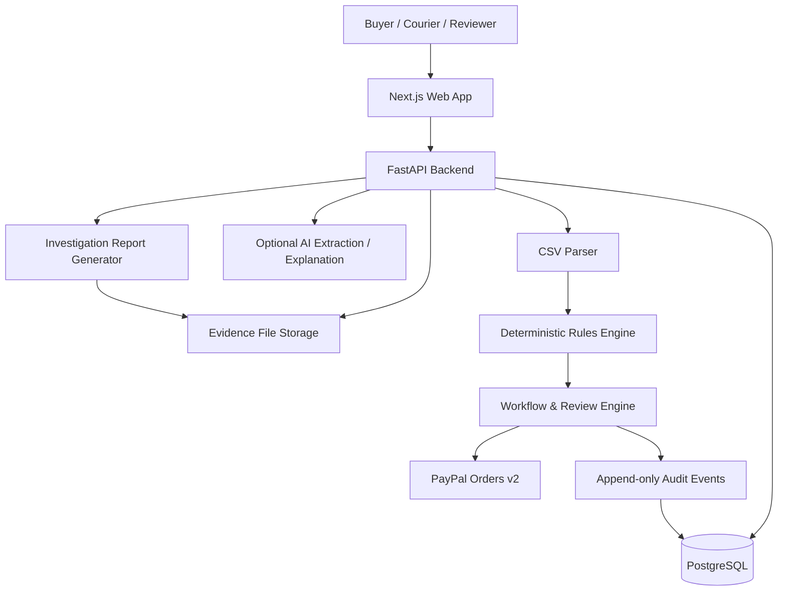

# System Architecture

## High-level flow

## Core design rule
The deterministic rules engine returns findings. The workflow engine checks those findings and reviewer permissions. Only the workflow engine can request a payment action. AI is outside the payment-authorisation path.

## Backend modules
- `shipments`: create/read/update shipment metadata.
- `profiles`: versioned product storage requirements.
- `evidence`: upload, hashing, parsing, metadata.
- `analysis`: deterministic temperature and evidence checks.
- `custody`: handover events.
- `reviews`: reviewer decisions and state transitions.
- `payments`: PayPal adapter and Demo Mode adapter.
- `audit`: immutable-by-application event history.
- `reports`: export generation.
- `analytics`: carrier metrics from stored shipments.

## Trust boundaries
- Browser input is untrusted.
- Uploaded files are untrusted.
- AI output is untrusted until human-confirmed.
- PayPal webhook payloads are untrusted until signature verification succeeds.
- Payment API responses are authoritative for PayPal payment state; persist raw status and relevant IDs.
- Product storage limits are only trusted after a source is recorded and an authorised user confirms them.

## State machine constraints
- `CAPTURED` can only follow successful PayPal capture response or verified corresponding webhook.
- `VOIDED` can only follow successful PayPal void response or verified corresponding webhook.
- `APPROVED` requires mandatory checks pass and reviewer decision.
- `REVIEW_REQUIRED` cannot transition directly to capture.
- Rejected or expired authorisations cannot be captured.
- Payment action endpoints must be idempotent.

## Data integrity
- Store original uploads separately from derived analysis.
- Hash original bytes using SHA-256.
- Store engine version, profile version, parser version, and analysis timestamp.
- Never overwrite old analysis; create a new analysis run.
- Audit records include actor, action, timestamp, entity, before/after state references, and reason.
